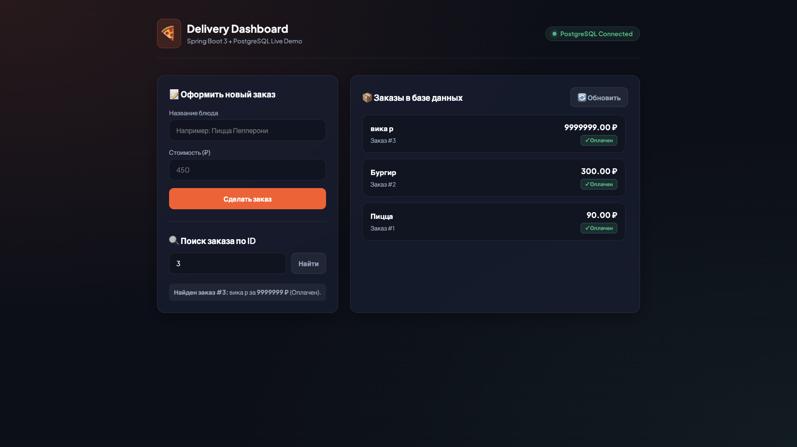

# 🍔 Delivery Service — Spring Boot 3 & PostgreSQL Backend

[](https://www.oracle.com/java/)
[](https://spring.io/projects/spring-boot)
[](https://www.postgresql.org/)
[](https://hibernate.org/)
[](https://maven.apache.org/)

Полнофункциональный бэкенд-сервис платформы доставки еды со слоеной архитектурой, персистентностью в PostgreSQL и встроенным веб-дашбордом.

Разработан в рамках подготовки к курсу **Java Advanced** и техническим собеседованиям на позицию Java Developer.

---

## 📸 Интерфейс приложения


> *Интерактивный дашборд на HTML5/CSS3, автоматически раздаваемый Spring Boot из `src/main/resources/static/`.*

---

## 🚀 Стек технологий

* **Язык:** Java 17
* **Фреймворк:** Spring Boot 3 (Spring Core, Spring MVC, Spring Data JPA)
* **ORM & База данных:** Hibernate 6, PostgreSQL 16
* **Валидация:** Jakarta Bean Validation (`@Valid`, `@NotBlank`, `@Positive`)
* **Конфигурация:** Inversion of Control (IoC), Dependency Injection strictly via Constructors
* **Frontend:** HTML5, CSS3 (Dark Theme Glassmorphism), Vanilla JavaScript (Fetch API)

---

## 🏛 Архитектура проекта

Проект строго следует принципу **Separation of Concerns (SoC)** и слоеной архитектуре:

```text
[HTTP Client / UI]
       │
       ▼
[OrderController]        <-- Валидация входных данных, маппинг в DTO, HTTP 201/400
       │
       ▼
[DeliveryOrderService]   <-- Бизнес-логика, интеграция с PaymentProcessor
       │
       ▼
[OrderRepository]        <-- Spring Data JPA (автоматическая генерация SQL)
       │
       ▼
[PostgreSQL Database]    <-- Персистентное хранилище (таблица orders)
```

### Архитектурные особенности:
* **Dependency Injection:** Полный отказ от Field Injection (`@Autowired` на полях). Все зависимости внедряются через конструкторы с модификатором `final`.
* **Слабое зацепление (SOLID):** Сервис заказов зависит от абстракции `PaymentProcessor`, а не от конкретных реализаций (`CardPaymentProcessor`, `CashPaymentProcessor`).
* **Централизованная обработка ошибок:** Использование `@RestControllerAdvice` для перехвата исключений (`OrderNotFoundException`) и возврата стандартизированных JSON-ответов (404 Not Found).
* **Модели данных:** Разделение на **Entity** (мутабельный класс Hibernate `@Entity Order`) и **DTO** (неизменяемый Java 17 `record OrderRequest`).

---

## 📡 REST API Эндпоинты

| Метод | URL | Описание | Успешный статус |
| :--- | :--- | :--- | :--- |
| **GET** | `/api/orders` | Получить список всех сохраненных заказов | `200 OK` |
| **GET** | `/api/orders/{id}` | Получить информацию о заказе по ID | `200 OK` *(или 404)* |
| **GET** | `/api/orders/info` | Проверка статуса сервиса | `200 OK` |
| **POST** | `/api/orders` | Оформить и сохранить новый заказ | `201 Created` *(или 400)* |

### Пример тела запроса (POST /api/orders):
```json
{
  "dishName": "Пицца Маргарита",
  "price": 650.0
}
```

---

## 🛠 Локальный запуск

### 1. Требования
* JDK 17+
* Установленный и запущенный PostgreSQL (база данных `Orders_db`)

### 2. Настройка подключения
В файле `src/main/resources/application.properties` укажи свой логин и пароль к PostgreSQL:
```properties
spring.datasource.url=jdbc:postgresql://localhost:5432/Orders_db
spring.datasource.username=postgres
spring.datasource.password=твой_пароль
```

### 3. Запуск
```bash
# macOS / Linux
./mvnw spring-boot:run

# Windows
.\mvnw.cmd spring-boot:run
```
После старта открой в браузере: **`http://localhost:8080`**.

---

## 👨‍💻 Автор
* **GitHub:** [@pyfas78](https://github.com/pyfas78)
